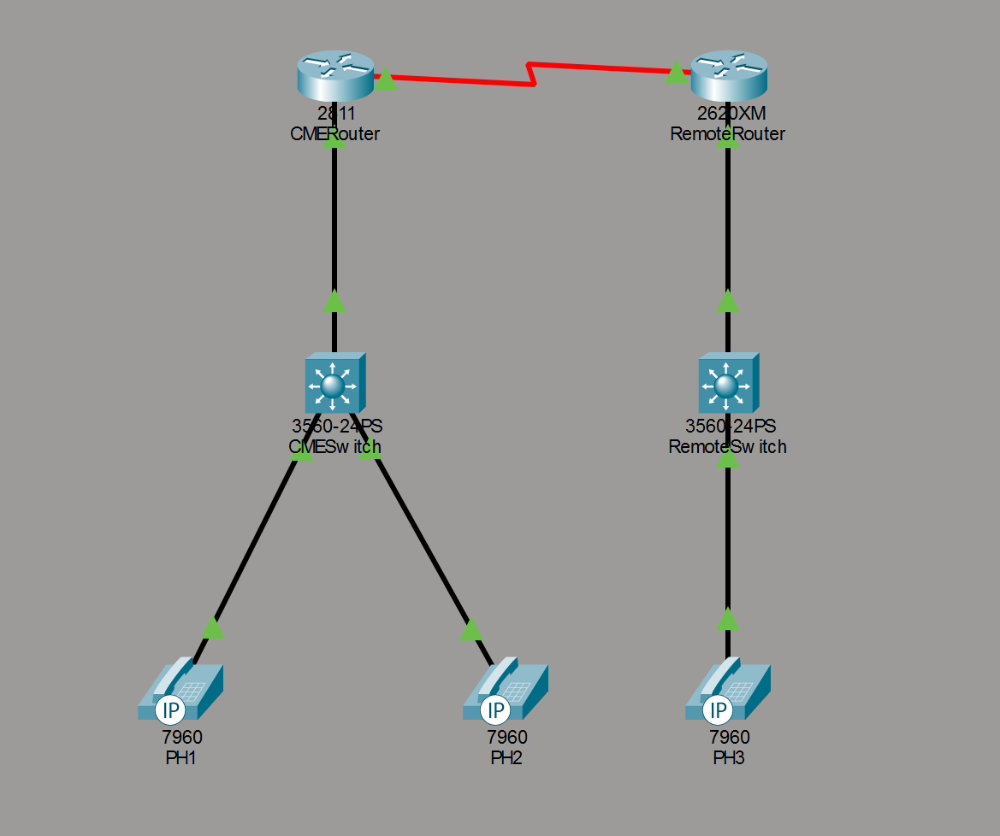

<div align="center">
<h1> PKT-BUILDER </h1>

**English** | [Русский](README.ru.md)

Builds a working `.pkt` file for **Cisco Packet Tracer** from a YAML description,
and does the reverse: exports an existing `.pkt` to YAML.

[](https://www.python.org/)
[](LICENSE)
[](https://github.com/nsaBogdan54/PKT-BUILDER/actions/workflows/tests.yml)
[](https://www.netacad.com/)

</div>
<div align="center">



</div>

The screenshot shows `8lab.pkt`, built by this tool from
[`examples/lab8.yml`](examples/lab8.yml) and opened in Packet Tracer 9.0.0
without any errors.

```powershell
pkt-builder -c configs\configuration.yml -i projects\my_new.pkt
pkt-builder --export 9lab.pkt -o 9lab.yml
```


## Installation

```powershell
pip install pkt-builder
```

Or from source (editable):

```powershell
git clone https://github.com/nsaBogdan54/PKT-BUILDER.git
cd PKT-BUILDER
pip install -e .
```

After installation you get the `pkt-builder` console command
(on Windows it is `Scripts\pkt-builder.exe`). It works from **any** directory:

```powershell
pkt-builder -c configs\configuration.yml -i projects\my_new.pkt
pkt-builder --export 9lab.pkt -o 9lab.yml
pkt-builder --help
```

How paths are resolved:

* `-c` / `-i` / `--export` / `-o` — relative to the **current directory**;
* `seed:` in the YAML — relative to the directory of the `.yml` file itself
  (an absolute path is used as is);
* the bundled donors (`lab3_donor.pkt`, `lab7_donor.pkt`) come from inside the
  package, so the examples and the export work without any external files.

There are no dependencies: PyYAML is used if it is installed, otherwise the
built-in `miniyaml.py` takes over. All you need is Python 3.10+.

```powershell
pip install pkt-builder[yaml]     # + PyYAML (faster and stricter)
```

You can also run it without installing, straight from the repository root:

```powershell
python -m pkt_builder -c examples\lab8.yml -i 8lab_new.pkt
python pkt_builder.py -c examples\lab8.yml -i 8lab_new.pkt
```

Both do exactly the same as `pkt-builder`. The old form
`python pkt_builder\pkt_builder.py` will not work: `pkt_builder` is a package,
and the CLI lives inside it (`cli.py`).

Setting `PKT_BUILDER_YAML=mini` in the environment forces the built-in parser.
That is handy for checking that your config does not depend on PyYAML.


### Structure

```
pkt_builder/                    repository root
├─ pkt_builder/                 package (pkt-builder / python -m pkt_builder)
│  ├─ __main__.py               entry point for -m
│  ├─ cli.py                    CLI: argument parsing, build, export
│  ├─ config.py                 YAML schema and validation
│  ├─ builder.py                LabSpec -> .pkt
│  ├─ exporter.py               .pkt -> YAML
│  ├─ ports.py                  port catalog and name abbreviations
│  ├─ verify.py                 structural check of the result
│  ├─ resources.py              access to the bundled donors and pt_accept.ps1
│  ├─ miniyaml.py               dependency-free YAML parser
│  ├─ data/                     lab3_donor.pkt, lab7_donor.pkt, 8lab_result.pkt, pt_accept.ps1
│  └─ _vendor/pkt_core/         .pkt library (GPL-3.0-or-later):
│     ├─ builder/               add_device / link / prune_seed_devices / save
│     ├─ codec/                 read and write the .pkt container (zlib + XML)
│     ├─ crypto/                payload signing and encryption
│     └─ data/                  device_templates.json, network_seed.xml
├─ pkt_builder.py               wrapper: python pkt_builder.py == pkt-builder
├─ build_8lab.py                script that produced the reference 8lab.pkt
├─ 8lab.pkt                     reference result (accepted by PT 9.0.0)
├─ pyproject.toml               package metadata, the pkt-builder entry point
├─ examples/                    sample YAML files
├─ tests/                       unit tests
├─ tools/                       verify_8lab.py
└─ docs/                        format, schema, validation
```


## Command-line options

| Option | Meaning |
|---|---|
| `-c, --config` | input `.yml` (build mode) |
| `-i, --input` | **output** `.pkt` (build mode); `-o` is an alias for it |
| `--export PKT` | export a `.pkt` to YAML (instead of building) |
| `-o, --output` | output `.yml` for `--export` (defaults to next to the `.pkt`); in build mode an alias for `-i` |
| `--export-seed` | what to write into `seed:` (default: the exported file itself) |
| `-s, --seed` | donor `.pkt` used as a template (default: the bundled `lab3_donor.pkt`) |
| `--check-only` | validate the config and print the plan, write nothing |
| `--no-verify` | skip the structural check of the result |
| `--accept` | also open the file in Packet Tracer (about 60 s, Windows only) |
| `-q / -v` | quiet mode / print every config line and port decision |

Paths understand `~`, `%USERPROFILE%` and `$HOME`.

Exit codes: `0` — success, `1` — config or build error, `2` — Packet Tracer
not found (`--accept`).


## YAML schema

```yaml
seed: my_donor.pkt                 # optional, relative to your .yml
defaults:                          # optional values for all devices
  power: true

devices:
  - model: 2911                    # key from the bundled model template library
    name: HQswitch
    pos: 200, 235                  # "x, y" | [x, y]; omit pos for auto-layout
    install: HWIC-2T               # a module or a list of modules
    power: true
    pc_ip: [10.0.0.10, 255.255.255.0, 10.0.0.1]   # PC / Server
    cfg: |
      hostname HQswitch
       ip address 10.0.0.1 255.255.255.0
       no shutdown
      end

links:
  - auto: [CMERouter, CMESwitch]
  - auto: [CMERouter, RemoteRouter, dce: CMERouter, clock: 64000]
  - [CMESwitch, Fa0/2, PH1, Switch]
  - [CMESwitch, Fa0/2, PH1, Switch, copper]
  - [CMERouter, Serial0/0/0, RemoteRouter, Serial0/0, serial, CMERouter, 64000]
  - [CMERouter, s0/0/0, RemoteRouter, s0/0/0, serial, CMERouter]
  - [R1, g0/0/0, R2, g0/1, copper]
```


### Devices

* `model` — a key from the bundled model template library
  (`pkt_builder/_vendor/pkt_core/data/device_templates.json`): `2911`, `2811`,
  `2620XM`, `3560-24PS`, `2960-24TT`, `7960`, `PC-PT`, `Server-PT`, … .
* `install` — a module or a list (`HWIC-2T`, `WIC-2T`, `NM-4A/S`, `NIM-2T` …).
  Without a module, a 2811 has no `Serial0/0/x` ports.
* `cfg` — lines (a block scalar) or a list of strings; each line is written as
  in the `show running-config` output. Leading extra spaces are preserved.
  Placeholders `{{mac:PH1}}`, `{{port_mac:PH1}}`, `{{client_id:PH1}}` and
  `{{name}}` are supported. `{{mac}}`/`{{client_id}}` are the device's own MAC
  (`<ENGINE><BUILD_IN_ADDR>`, or the first copper port when the model has no
  chassis address) — that is what Packet Tracer shows for a phone and what
  `ephone mac-address` matches. `{{port_mac}}` is the first port's MAC.
  Addresses are read from the XML after the devices are created.


### Links

Full port form:

```
[device_a, port_a, device_b, port_b, (kind), (dce), (clock)]
```

| Form | Meaning |
|---|---|
| `[A, B]` / `auto: [A, B]` | pick the cable type and free ports automatically |
| `auto: [A, B, dce: A, clock: 64000]` | auto-pick, but make it a serial link |
| `[A, portA, B, portB]` | cable type is inferred from the port names |
| `[A, portA, B, portB, copper\|serial]` | cable type given explicitly |
| `[.., serial, DCE]` | clock = 64000 by default |
| `[.., serial, DCE, 64000]` | clock given explicitly |

Three-element links (`[A, B, copper]`) are rejected as ambiguous.

Port names can be abbreviated: `Fa0/2`, `g0/0/0`, `s0/0/0`. The tool expands
them to the canonical form (`FastEthernet0/2`, …) and **checks that the device
actually has that port**. Otherwise Packet Tracer would show
"Incompatible File".

The 7960 phone has two ports with non-standard names: `Switch` (uplink) and
`PC` (passthrough): `[CMESwitch, Fa0/2, PH1, Switch]`.

The order "devices → links → configs" is applied automatically, so a
`clock rate` on a DCE port is not overwritten by the config.


## Verifying the result

After a build, a structural check runs without Packet Tracer: the `VERSION`
tag, the device count, `Switch` on the 7960, `DCEDEV/DCEPORT` and clock rate on
serial links, `POWER` on copper ports, and duplicate cables. The outcome is a
single line `VERDICT : structure looks OK` or a list of `ERROR`s.

A real check:

```powershell
pkt-builder -c examples\lab8.yml -i out.pkt --accept
```

`--accept` runs the bundled `pt_accept.ps1`, which looks for Packet Tracer only
at **hard-coded paths**:

```
C:\Program Files\Cisco Packet Tracer 9.0.0\bin\PacketTracer.exe
C:\Program Files\Cisco Packet Tracer 8.2.2\bin\PacketTracer.exe
C:\Program Files (x86)\Cisco Packet Tracer 8.2.2\bin\PacketTracer.exe
```

If Packet Tracer is installed somewhere else, or you are not on Windows,
`--accept` exits with code `2` (`PacketTracer.exe not found`). This is expected:
the build itself does not depend on it. To add your own path, append it to the
`$pt` array in `pkt_builder/data/pt_accept.ps1`. The script closes a running
Packet Tracer before the check and after it. If the script itself is missing,
the command prints `pt_accept.ps1 not found (--accept is Windows-only)` and
returns `2`.


## Export `.pkt` → YAML

```powershell
pkt-builder --export 9lab.pkt -o 9lab.yml
pkt-builder --export 9lab.pkt          # -> 9lab.yml next to the .pkt
```

Everything needed for a rebuild is restored:

* `model`, `name`, `pos` (from `WORKSPACE/LOGICAL`), `install` (installed
  interface cards), `power: false` for powered-off devices, `description`;
* `cfg` — the full `RUNNINGCONFIG`, line by line (a `|` block scalar);
* for PC/Server — `pc_ip` and `dhcp`;
* `links` — with explicit ports; for serial links, `dce` (from `DCEDEV`) and
  `clock` (from the DCE port's `CLOCKRATE`);
* `seed:` — the path to the source `.pkt`, because its `VERSION` is guaranteed
  to open in your Packet Tracer (relative to the output `.yml` directory).

The exported YAML is a normal input file: `-c exported.yml -i new.pkt` builds
the same topology. This round-trip has been verified — devices, configs and
links match, and the file is accepted by PT 9.0.0.


## Examples

| File | What it shows |
|---|---|
| `examples/lab8.yml` | the full lab 8 (CME + remote site), equivalent to `8lab.pkt` |
| `examples/link_forms.yml` | every way to write `links` |
| `examples/end_devices.yml` | PC/Server with `pc_ip`, auto-layout |
| `examples/two_sites.yml` | two routers, two switches, a serial link between them |
| `examples/minimal.yml` | the minimum: one device and a config |
| `examples/bad_phone_port.yml` | what the phone-port error looks like |


## Tests

```powershell
python -m unittest discover -s tests -p "test_*.py"
```

The tests build the examples into a temporary directory, so nothing in the
repository is changed. `--accept` is not part of the test run because it needs
an installed Packet Tracer. Tests that require PyYAML are skipped when it is
missing.


## Limitations

* Models whose interface names cannot be derived from a template (hubs, IoT,
  Cloud-PT) are checked more loosely: the port is accepted as written.
* `VERSION` comes from the donor file. If your Packet Tracer is older than the
  donor, the file will be rejected. Put your own `.pkt` anywhere and pass it as
  `-s path\to\own.pkt` (or set `seed:` in the YAML).
* Wireless links (`set_wireless`) are not configurable through YAML yet — only
  cable links are supported.
* `--accept` works on Windows only (see above).


## Disclaimer

1. **Educational use:** This tool was created solely to automate educational
   lab work and for educational purposes.
2. **API costs:** The author is not responsible for any financial expenses
   users may incur from third-party APIs (e.g. RouterAI, OpenAI and others)
   used to generate YAML configs or to run the script.
3. **Cisco Packet Tracer EULA:** Cisco Packet Tracer is proprietary software of
   Cisco Systems, Inc. Using this generator must not violate Cisco's End User
   License Agreement (EULA). The author is not affiliated with Cisco Systems
   and is not responsible for the consequences of using generated `.pkt` files
   in commercial or production environments.

## Acknowledgements

This project uses a modified version of the `.pkt` decoding and generation
library from
[aacanadaa/packet-tracer-pkt-format](https://github.com/aacanadaa/packet-tracer-pkt-format).
The original code is distributed under the GNU GPLv3, which is why the whole
package is licensed the same way.

## License

The project is distributed under the
**GNU General Public License v3.0 or later** (GPL-3.0-or-later). The full text
is in [LICENSE](LICENSE).

The vendored code in `pkt_builder/_vendor/pkt_core/` is a third-party library
`pkt_core` (© its author), also under GPL-3.0-or-later; its SPDX headers are
kept unchanged. The rest of `pkt_builder` is under GPL-3.0-or-later as well
(see the `# SPDX-License-Identifier: GPL-3.0-or-later` header in every module).
